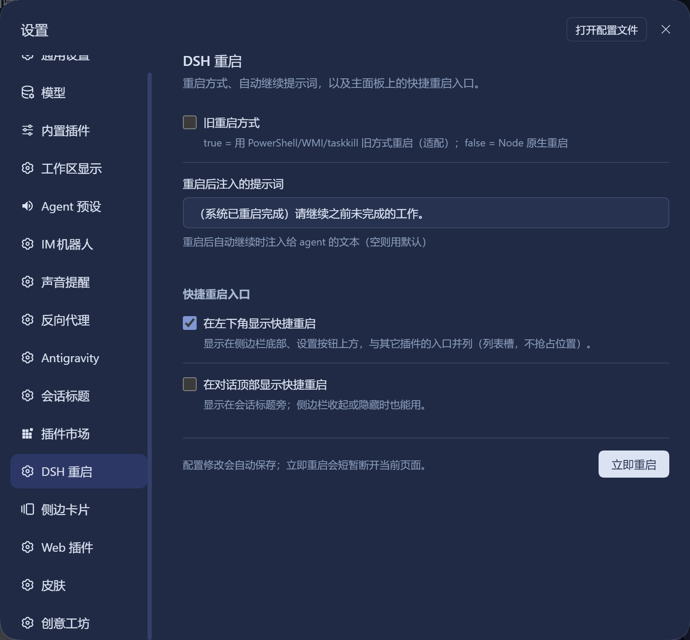

# @erick0412-dev/dsh-restart

> **DeepSeek Harness 的进程重启与任务接续插件。**  
> 一键重启、配置秒生效；AI 自主重启并接续任务；专为 DSH 0.1.7+ 设计。

[](https://www.npmjs.com/package/@erick0412-dev/dsh-restart)
[](./LICENSE)
[](#)
[](#)

<br/>

<p align="center">
  
</p>

## 痛点对比

| 场景 | 传统方式 😫 | 使用 dsh-restart ✨ |
| :--- | :--- | :--- |
| **装插件 / 改配置** | 切到命令行 `Ctrl+C`、甚至找 PID 手动 `kill` | 界面左下角直接点 `↻`，或输入 `/restart` |
| **重启后网页体验** | 页面报 404 / 丢失连接，需要反复手动刷新 | **原地平滑等待**，新服务启动后自动提示「重启完成」 |
| **Agent 自主迭代** | AI 改完配置/装好插件后只能提示“请您重启一下” | AI 调用 `restart_harness` 重启，**重启后自动接着干** |

---

## 三大核心特性

### 1. 👤 用户可重启
- **快捷入口**：左下角动作栏（设置按钮正上方）与会话顶栏双可选入口，按键折叠自动缩为图标。
- **二次确认**：状态机弹窗拦截，支持 `Enter` 确认、`Esc` 退出，彻底防止误触。
- **免刷重连**：监听新进程 PID 与网页端挂载状态，原地完成状态恢复。

### 2. 🤖 AI 可重启（自动续接任务）
- **模型工具**：暴露原生 `restart_harness` 工具，赋予 Agent 重启 Harness 的安全闭环能力。
- **任务不断流**：重启后自动投递接续消息，驱动模型恢复上一会话的未尽任务。

### 3. ⚡ 适配 DSH 0.1.7+
- **全新插槽**：使用 `settings.section` 独立设置页，解决 0.1.7 插槽废弃问题。
- **Session v4**：采用自有生产者 `source.kind: 'dsh-restart'`，严格遵循 0.1.7+ 会话契约。
- **Node 原生**：跨平台纯 Node 派生守护，无外部 shell/WMI 依赖，干净释放端口。

---

## 快速安装

```bash
dsh plugin --profile web add @erick0412-dev/dsh-restart
```

在 Web UI 中打开 **设置 → 左侧「DSH 重启」** 即可根据习惯调整入口与自动续跑提示词。

---

## 协议与致谢

- 基于 [anweat/dsh-restart](https://github.com/anweat/dsh-restart) 进行现代化重构。
- 遵循 [MIT License](./LICENSE)。
